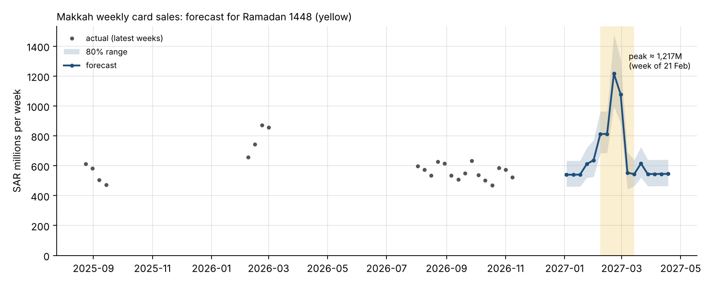
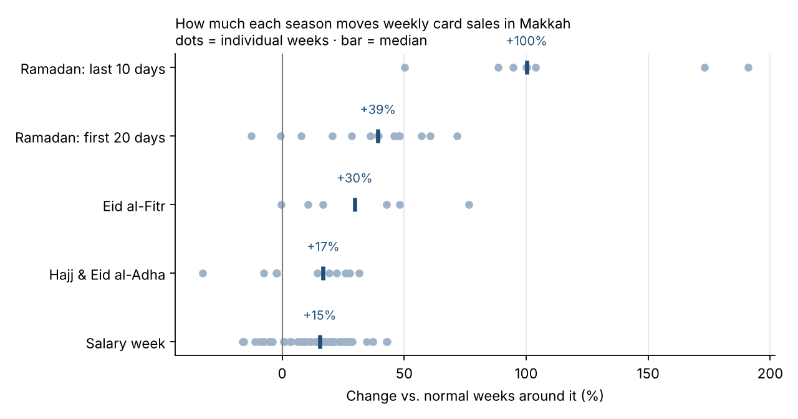
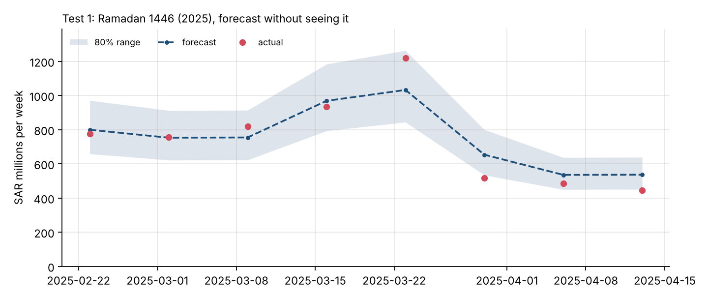

# Makkah Retail Seasons

How much do Ramadan, Hajj and payday change card spending in Makkah, and how much should the city expect in Ramadan 1448 (Feb–Mar 2027)?

This project uses public data from SAMA (the Saudi Central Bank) on weekly point-of-sale transactions. The data is cleaned with a human-in-the-loop review, each season's effect is measured against normal weeks, and a forecast is built and tested on weeks the model never saw.



## Key findings

**Seasons compared with a normal week** (normal weeks nearby are the baseline, so growth over the years doesn't inflate the numbers):

| Season | Median uplift | Weeks |
|---|---|---|
| Ramadan: last 10 days | **+100%** | 8 |
| Ramadan: first 20 days | +39% | 14 |
| Eid al-Fitr | +30% | 6 |
| Hajj & Eid al-Adha | +17% | 10 |
| Salary week (contains the 27th) | +15% | 55 |

- **Ramadan is Makkah's biggest season, bigger than Hajj.** The peak Ramadan week was 534M SAR in 1442 AH and 1,076M in 1446 AH, consistently about 2× a normal week.
- **During Ramadan, Makkah's share of national card spending jumps** from 3.7% in a normal week to 6.1% in the last 10 days. During Hajj it stays at 3.7%.
- **Growth is slowing.** A normal week went from about 250M SAR (1442 AH) to 495M (1446 AH), but most of that rise came in the early years.

**Forecast for Ramadan 1448:**
- Peak week starting 21 Feb 2027: about **1.2 billion SAR**, with an 80% range of 1.0–1.5bn.
- Ramadan plus Eid (5 weeks): about **4.5 billion SAR** in card sales.



## How the forecast was tested

The model is a regression on log sales: a growth trend plus one multiplier per season. It was kept simple on purpose, so that every number in it can be explained to a business reader. It is trained on the most recent 2 years.

| Test | Model error (MAPE) | Naive guess* |
|---|---|---|
| Ramadan 1446 (2025), hidden from training | **11.0%** | 28.7% |
| 2025–26 weeks from SAMA's PDF reports, trained on data to Jul 2025 | **6.4%** | 15.9% |

\*The naive guess repeats the average of the last 8 weeks.

**Known weakness:** in Test 1 the model under-forecast the very top week (1,033M forecast vs 1,218M actual), so the peak forecast for 1448 is more likely too low than too high.



## Data-quality process

The checks are built so that an automated agent could run them later, while every decision that changes the data stays with a person.

```
01 structural cleaning → 02 automatic checks → human review → 03 apply decisions → analysis
   (no judgement)        (finds, never fixes)  decisions.csv  (only what was approved)
```

- 6 automatic checks: missing or duplicate weeks, irregular week spacing, parts not summing to the total, city-name mismatches, outliers, and values SAMA changed between reports.
- Each issue gets a stable ID and a ranking. Outliers are tagged with the Hijri or Gregorian event that week, such as Ramadan, National Day or salary week.
- 212 issues were reviewed by hand and the decisions are recorded in [`data/review/decisions.csv`](data/review/decisions.csv). For example, `Hail → Hayel` was mapped, `Other` vs `Others` was kept separate, and outliers explained by real events were kept.
- One real finding from the review: a jump across almost every city in the week of 27 Sep 2026 turned out to be a salary week right after National Day. Salary week was added as a calendar event, and medium-severity outlier flags dropped from 18 to 7.

Details: [DATA_QUALITY_PROCESS.md](DATA_QUALITY_PROCESS.md)

## Notebooks

| Notebook | What it does |
|---|---|
| `01_structural_cleaning.ipynb` | Fixes layout, dates and units, extracts the PDF tables, and merges both sources |
| `02_data_quality_review.ipynb` | Runs the automatic checks and builds the review queue |
| `03_apply_decisions.ipynb` | Applies the reviewer's decisions, adds Hijri calendar flags, and saves clean data |
| `04_season_effects.ipynb` | Measures each season's uplift and Makkah's share of national spending |
| `05_forecast.ipynb` | Builds and backtests the model, then forecasts Ramadan 1448 |

Each notebook is generated from its `build_0X.py` script. The checks live in [`dq/checks.py`](dq/checks.py).

## Data

- [KAPSARC Data Portal](https://datasource.kapsarc.org/explore/dataset/point-of-sale-transactions-by-sector-and-city/): SAMA weekly POS by city and sector, May 2020 – Jul 2025 (`data/raw/kapsarc_pos.csv`)
- SAMA weekly POS reports (PDF, from sama.gov.sa): the weeks still published, up to Nov 2026 (`data/raw/sama_pdfs/`)

## Limits

- Coverage has gaps: SAMA only keeps its latest reports online. Missing weeks are listed in `data/interim/coverage_gaps.csv` and are not filled in.
- Card payments only, so cash spending isn't counted.
- Weeks before 21 Jun 2020 (COVID lockdown) are excluded from the analysis.
- Hijri dates are calculated with the Umm al-Qura calendar, so a one-day shift in the start of Ramadan moves the weeks slightly.

## Run

```bash
pip install pandas numpy matplotlib statsmodels pdfplumber hijridate nbformat jupyter
for i in 1 2 3 4 5; do python build_0$i.py && jupyter nbconvert --to notebook --execute --inplace 0${i}_*.ipynb; done
```

---
Maher Al-Qurashi · Makkah
